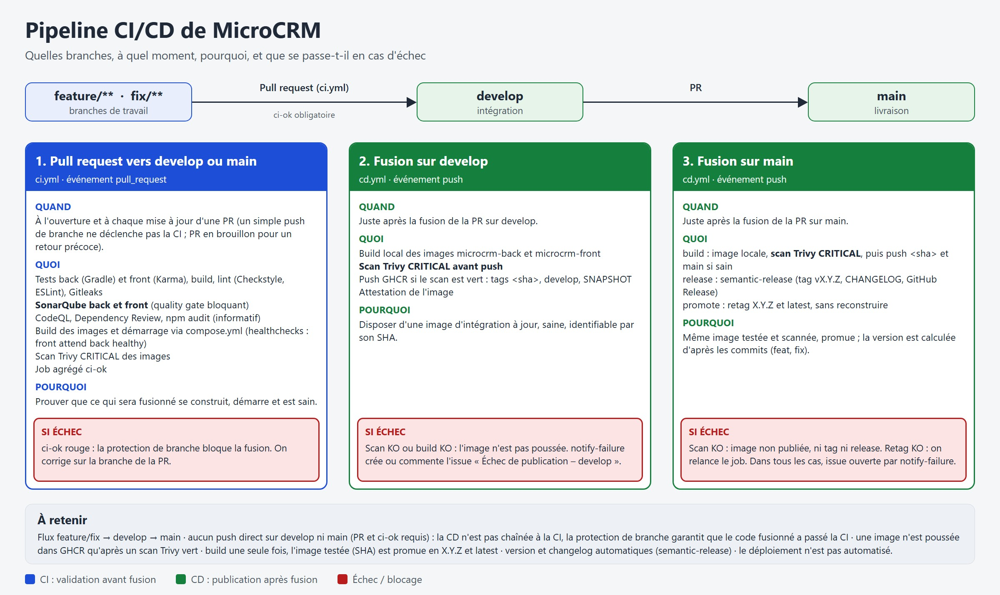

# Pipeline CI/CD

## 1. Flux et déclencheurs

`feature/**` ou `fix/**` → PR → `develop` → PR → `main`. Aucun push direct sur `develop` ni `main` : PR obligatoire et check `ci-ok` requis.

| Événement | Workflow | Ce qui s'exécute | Pourquoi |
|-----------|----------|------------------|----------|
| PR vers `develop` ou `main` | `ci.yml` | Tests back et front, build, Checkstyle, ESLint, SonarQube (back et front, quality gate bloquant), Gitleaks, CodeQL, Dependency Review, `npm audit`, build et démarrage des images (`compose.yml`, healthchecks), Trivy ; job agrégé `ci-ok` | Condition de fusion |
| Fusion sur `develop` | `cd.yml` | Build `back` et `front`, scan Trivy, push GHCR (`<sha>`, `develop`, `SNAPSHOT`), attestation | Image d'intégration |
| Fusion sur `main` | `cd.yml` | Build + scan avant push → release → promotion | Livrer une version |
| Manuel | `ci.yml`, `cd.yml` (*Run workflow*) | En manuel, `cd.yml` construit sans publier | Relance |

Un simple push de branche ne déclenche pas la CI (pas de double exécution push + PR) : ouvrir une PR en brouillon pour un retour rapide. La CD n'est pas chaînée à la CI : la protection de branche garantit que le code fusionné a passé la CI.

Jobs de `cd.yml` :
1. **build** (matrice `back`, `front`) : image construite localement, **scan Trivy** (CRITICAL), push GHCR **uniquement si le scan est vert**.
2. **release** (`main`) : semantic-release (version, `CHANGELOG.md`, tag `vX.Y.Z`, GitHub Release).
3. **promote** : retag `:<sha>` en `:X.Y.Z` et `:latest`, **sans reconstruire**.
4. **notify-failure** : ouvre ou commente l'issue « Échec de publication – <branche> » (label `publish-failure`).

## 2. En cas d'échec

| Où | Conséquence | Action |
|----|-------------|--------|
| PR | `ci-ok` rouge : fusion bloquée | Corriger sur la branche de la PR |
| `build` (CVE critique ou erreur) | Image non poussée, pas de release ; issue ouverte | Corriger la dépendance ou l'image de base, nouvelle PR (ou relancer si cause temporaire) |
| `release` | Pas de version ; issue ouverte | Vérifier `RELEASE_TOKEN` (expiration, bypass de la protection) |
| `promote` | Release créée, tags `X.Y.Z` / `latest` absents | Relancer le job (aucune reconstruction) |

## 3. Tags d'images et versions

Images : `ghcr.io/mikedel88/microcrm-back` et `microcrm-front`.

| Tag | Branche | Nature |
|-----|---------|--------|
| `<sha>` | `develop`, `main` | Immuable : référence de déploiement |
| `develop` / `main`, `SNAPSHOT` | `develop` / `main` | Mobile : dernier build |
| `X.Y.Z` | `main` | Immuable : version livrée |
| `latest` | `main` | Mobile : dernière version stable |

Version calculée par semantic-release d'après les commits conventionnels : `fix:` → correctif, `feat:` → mineure, `feat!:` / `BREAKING CHANGE:` → majeure ; `chore:`, `docs:`, `ci:` → pas de release.

## 4. Mise en place

**Secrets** (Settings → Secrets and variables → Actions) :

| Secret | Rôle |
|--------|------|
| `SONAR_TOKEN_BACK`, `SONAR_TOKEN_FRONT` | Analyses SonarQube Cloud des projets `mikedel88_microcrm_back` et `mikedel88_microcrm_front` (créer les deux projets, désactiver l'analyse automatique, un jeton par projet) |
| `RELEASE_TOKEN` | PAT *fine-grained* limité au dépôt (Contents, Issues, Pull requests en écriture, expiration ≤ 90 jours) : push du changelog et du tag sur `main` protégée |
| `GITHUB_TOKEN` | Automatique : GHCR, Gitleaks, issues |

**Réglages GitHub** :
- Protection de `main` et `develop` : PR obligatoire, check requis **`ci-ok`**, force-push interdit ; ajouter le compte du PAT en *bypass* (push du changelog sans PR).
- Issues et *Dependency graph* activés ; CodeQL en configuration avancée (désactiver la configuration par défaut).
- Packages GHCR privés par défaut : `docker login ghcr.io` pour les tirer, ou les rendre publics.

## 5. Lancer chaque étape en local

| Étape | Commande |
|-------|----------|
| Tests back | `cd back && ./gradlew test` (profil `test`, rapport JaCoCo) |
| Lint back | `./gradlew checkstyleMain checkstyleTest` |
| Tests front | `cd front && npm ci && npm run test:ci` (Chrome headless, couverture lcov) |
| Lint front | `npm run lint` |
| Application complète (build local) | `docker compose up -d --build` puis `docker compose ps` (état `healthy`) ; arrêt `docker compose down -v` |
| Version publiée | `TAG=1.2.0 docker compose -f compose.yml -f compose.release.yml up -d` (PowerShell : `$env:TAG="1.2.0"; docker compose …`) |
| Retour arrière | Même commande avec le `TAG` précédent |
| Supervision | `./elk.sh up` — voir [03](03-supervision-elk.md) |
| Tester la release sans publier | `npx semantic-release --dry-run --no-ci` (à la racine, avec `GITHUB_TOKEN`) |

Front : https://localhost (certificat interne de Caddy) ; API : http://localhost:8080.
