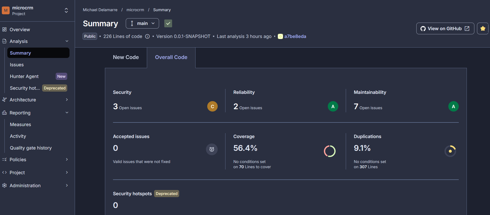
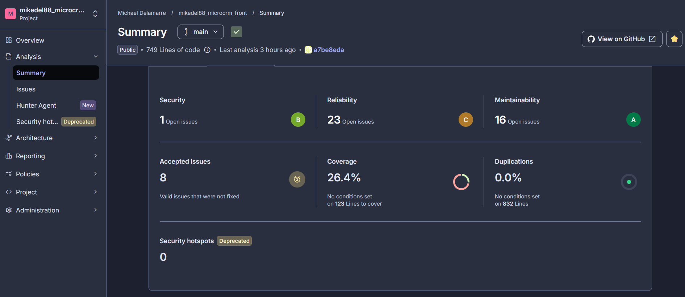

# Analyse des résultats SonarQube

Objectif : identifier, à partir des résultats SonarQube Cloud, les **vulnérabilités**, les **duplications de code**, les **zones à forte complexité**, les **règles critiques violées** et la **couverture de tests** de MicroCRM. On en tire ensuite un plan d'action priorisé.

Relevé du **27/10/2026** : dernière analyse de la branche `main` (run CI #87), sur les projets `mikedel88_microcrm_back` (226 lignes de code, 7 fichiers) et `mikedel88_microcrm_front` (749 lignes de code, 23 fichiers). Les indicateurs de synthèse sont repris dans [12 Métriques DORA et KPI](12-dora-kpi.md), section 3.7.

## Référentiel : règles SonarSource appliquées

Les deux projets utilisent le profil qualité par défaut de l'organisation, **Sonar way comprehensive**. Il est plus large que le profil « Sonar way » de base.

| Partie | Langage analysé | Règles actives |
|---|---|---|
| Back (Spring Boot) | Java | 670 |
| Front (Angular) | TypeScript (composants, services) | 496 |
| Front (Angular) | Web (templates HTML) | 61 |
| Front (Angular) | CSS | 49 |

Il n'existe pas de jeu de règles « Angular » séparé. Un projet Angular est couvert par les règles TypeScript, pour la logique (promesses, cycle de vie, typage), et par les règles Web, pour les templates (accessibilité, sécurité des ressources).

Règles levées sur MicroCRM, telles que décrites par SonarSource. On peut consulter chaque règle dans SonarQube Cloud (*Rules*, recherche par clé) ou sur [rules.sonarsource.com](https://rules.sonarsource.com) :

| Clé | Intitulé SonarSource | Type | Sévérité | Impact (qualité / niveau) | Tags |
|---|---|---|---|---|---|
| `java:S5122` | CORS policy should be restricted to trusted origins | Vulnérabilité | Majeure | Sécurité / moyen | `cwe`, `spring` |
| `java:S6813` | Field dependency injection should be avoided | Code smell | Majeure | Maintenabilité et fiabilité / moyen | – |
| `java:S1170` | Fields initialized at declaration should be "static final" | Code smell | Mineure | Maintenabilité / faible | `convention` |
| `java:S2143` | "java.time" classes should be used for dates and times | Code smell | Info | Maintenabilité / info | `java8`, `pitfall` |
| `java:S5786` | JUnit5 test methods should have default package visibility | Code smell | Info | Maintenabilité / info | `junit`, `tests` |
| `typescript:S7059` | Constructors should not contain asynchronous operations | Code smell | **Critique** | Fiabilité et maintenabilité / **élevé** | `es2017` |
| `typescript:S9383` | Promises should not be left unhandled | Bug | Majeure | Fiabilité / moyen | `async`, `promise` |
| `typescript:S2933` | Fields only assigned in the constructor should be "readonly" | Code smell | Majeure | Maintenabilité / moyen | `confusing` |
| `typescript:S7773` | Number static methods should be preferred over global equivalents | Code smell | Mineure | Fiabilité / moyen | `convention` |
| `typescript:S3626` | Jump statements should not be redundant | Code smell | Mineure | Maintenabilité / faible | `redundant` |
| `typescript:S1128` | Unnecessary imports should be removed | Code smell | Mineure | Maintenabilité / faible | `unused` |
| `Web:S5725` | Remote artifacts should not be used without integrity checks | Vulnérabilité | Mineure | Sécurité / faible | `cwe` |
| `Web:InputWithoutLabelCheck` | "input", "select" and "textarea" tags should be labeled | Bug | Majeure | Fiabilité / moyen | `accessibility`, `wcag2-a` |
| `Web:S5256` | Tables should have headers | Bug | Majeure | Fiabilité / moyen | `accessibility`, `wcag2-a` |
| `Web:S6853` | Label elements should have a text label and an associated control | Code smell | Majeure | Fiabilité / moyen | `accessibility` |
| `Web:MouseEventWithoutKeyboardEquivalentCheck` | Mouse events should have corresponding keyboard events | Bug | Mineure | Fiabilité / faible | `accessibility` |
| `css:S4667` | CSS files should not be empty | Code smell | Majeure | Maintenabilité / moyen | – |

Les deux règles de sécurité (`S5122`, `S5725`) portent le tag `cwe` : elles correspondent à des faiblesses répertoriées dans la classification CWE. `S5122` est aussi une ancienne règle de *security hotspot*, passée en vulnérabilité.

## Synthèse

| Axe | Back | Front |
|---|---|---|
| Quality gate (nouveau code) | **OK** | **OK** |
| Vulnérabilités | 3 (majeures), note sécurité **C** | 1 (mineure), note sécurité **B** |
| Duplication | **9,1 %** (28 lignes, 2 blocs) | 0,0 % |
| Complexité cyclomatique / cognitive | 33 / 3 | 58 / 15 |
| Bugs | 0, note fiabilité **A** | **20** (majeurs), note fiabilité **C** |
| Règles critiques violées | 0 | **1** |
| Couverture | **56,4 %** | **26,4 %** |

Le quality gate est vert, car il ne contrôle que le **nouveau code**. Les problèmes ci-dessous viennent du code hérité du projet de départ : le gate ne les bloque pas, mais ils restent à traiter.

### Tableaux de bord SonarQube Cloud

Les deux captures montrent la vue *Summary > Overall Code* de la branche `main`, sur le commit `a7be8eda`. C'est la même analyse que le relevé.

**Back** (`mikedel88_microcrm_back`) :

**Front** (`mikedel88_microcrm_front`) :

**Lire les compteurs.** Le tableau de bord compte les issues par **impact** (sécurité, fiabilité, maintenabilité). Une même issue peut toucher plusieurs qualités. Les sections ci-dessous les classent par **type** (vulnérabilité, bug, code smell). Les deux comptes ne se recoupent donc pas toujours :

| Compteur du tableau de bord | Back | Front | Correspondance |
|---|---|---|---|
| Security | 3 | 1 | les vulnérabilités de la section 1 |
| Reliability | 2 | 23 | back : les 2 injections par champ (`java:S6813`) ; front : les 20 bugs, plus 3 code smells qui touchent aussi la fiabilité (`S7059` et 2 × `S7773`) |
| Maintainability | 7 | 16 | les code smells |
| Accepted issues | 0 | **8** | issues marquées « acceptées », donc hors des issues ouvertes (voir section 4) |

## 1. Vulnérabilités

| Projet | Règle | Sévérité | Emplacement | Problème | Risque |
|---|---|---|---|---|---|
| Back | `java:S5122` | Majeure | `PersonRepository.java:12` | CORS activé sans restriction (`@CrossOrigin`) | N'importe quel site peut appeler l'API depuis le navigateur d'un utilisateur |
| Back | `java:S5122` | Majeure | `OrganizationRepository.java:8` | idem | idem |
| Back | `java:S5122` | Majeure | `SpringDataRestCustomization.java:15` | CORS global ouvert dans la configuration Spring Data REST (`allowedOrigins("*")` sur `/**`) | idem, pour tous les endpoints exposés |
| Front | `Web:S5725` | Mineure | `src/index.html:9` | Ressource externe chargée sans `integrity` ni `crossorigin` (SRI) | Un CDN compromis pourrait injecter du code dans l'application |

Il n'y a aucun *security hotspot* à revoir sur les deux projets.

**Lecture.** Les trois vulnérabilités du back ont une seule cause : une politique CORS trop permissive. Une configuration centralisée, qui n'autorise que l'origine du front (par environnement), corrige les trois d'un coup. Il faudra alors retirer les `@CrossOrigin` des repositories.

## 2. Duplications de code

| Projet | Lignes dupliquées | Blocs | Fichiers | Taux |
|---|---|---|---|---|
| Back | 28 | 2 | 2 | **9,1 %** (objectif < 3 %) |
| Front | 0 | 0 | 0 | 0,0 % |

Le seul bloc dupliqué fait 14 lignes. On le trouve à l'identique dans :
- `back/.../Person.java`, lignes 90 à 103 ;
- `back/.../Organization.java`, lignes 67 à 80.

Il contient les champs d'horodatage `createdAt` / `updatedAt` (`@CreationTimestamp`, `@UpdateTimestamp`) et leurs accesseurs.

**Lecture.** Le taux paraît élevé parce que le back est petit : 28 lignes sur 226. La correction est simple. Il suffit d'extraire ces champs dans une classe parente `@MappedSuperclass` (par exemple `AuditableEntity`), dont héritent `Person` et `Organization`. Le taux retombe alors à 0 %.

## 3. Zones à forte complexité

Sonar mesure deux complexités :
- la **complexité cyclomatique** compte les chemins possibles dans le code, ce qui donne le nombre minimal de tests pour tout couvrir ;
- la **complexité cognitive** mesure la difficulté de lecture (imbrications, ruptures de flux).

| Fichier | Lignes | Cyclomatique | Cognitive | Couverture |
|---|---|---|---|---|
| `front/src/app/person-details/person-details.component.ts` | 78 | **21** | **7** | 26,7 % |
| `back/.../Person.java` | 84 | 17 | 1 | 45,2 % |
| `back/.../Organization.java` | 64 | 11 | 2 | 36,4 % |
| `front/src/app/organization-details/organization-details.component.ts` | 54 | 11 | 4 | 36,0 % |
| `front/src/app/organization.service.ts` | 72 | 9 | 2 | 12,5 % |
| `front/src/app/person.service.ts` | 69 | 7 | 2 | 14,8 % |

Aucun fichier n'approche le seuil habituel de Sonar (complexité cognitive de 15 par fonction). La complexité reste donc **faible** dans l'absolu.

**Lecture.**
- `person-details.component.ts` est la vraie zone à risque. C'est le fichier le plus complexe, et il cumule la règle critique, 8 des 20 bugs et une couverture de 26,7 %.
- La complexité cyclomatique élevée de `Person.java` et `Organization.java` est trompeuse. Elle vient des nombreux getters et setters, et non d'une logique métier (complexité cognitive de 1 et 2).

## 4. Règles critiques violées

Aucune règle **BLOCKER** n'est violée. Une règle **CRITICAL** l'est, et plusieurs règles **MAJOR** sont à l'origine des bugs.

| Sévérité | Règle | Occurrences | Emplacement | Problème |
|---|---|---|---|---|
| **Critique** | `typescript:S7059` | 1 | `person-details.component.ts:33` | Opération asynchrone lancée dans le constructeur ; elle doit être déplacée dans `ngOnInit` |
| Majeure (bug) | `typescript:S9383` | 12 | composants `person-details`, `organization-details`, `main-dashboard` | Promesses ni attendues ni suivies d'un `.catch` : les erreurs réseau sont ignorées en silence |
| Majeure (bug) | `Web:InputWithoutLabelCheck` | 7 | `person-details.component.html` (6), `organization-details.component.html` (1) | Champs de saisie sans `<label>` associé (accessibilité) |
| Majeure (bug) | `Web:S5256` | 1 | `person-details.component.html:179` | Tableau sans en-têtes `<th>` (accessibilité) |
| Majeure | `java:S6813` | 2 | `InitialDataFixture.java:14, 17` | Injection par champ (`@Autowired`) au lieu de l'injection par constructeur |
| Majeure | `typescript:S2933` | 5 | composants et services | Membres jamais réaffectés à déclarer `readonly` |
| Majeure | `css:S4667` | 4 | fichiers `.css` des composants | Fichiers CSS vides |

Il reste aussi des règles mineures et informatives : `return` inutiles, `parseInt` au lieu de `Number.parseInt`, `java.util.Date` au lieu de `java.time`.

**Issues acceptées (front, 8).** Elles ne figurent pas dans les comptes d'issues ouvertes, car elles ont été marquées *Accepted* dans SonarQube Cloud, c'est-à-dire un risque accepté et non corrigé :

| Règle | Occurrences | Emplacement | Problème |
|---|---|---|---|
| `Web:S6853` | 6 | `person-details.component.html` (5), `organization-details.component.html` (1) | Libellé de formulaire non associé à un contrôle (accessibilité) |
| `Web:MouseEventWithoutKeyboardEquivalentCheck` (bug) | 1 | `person-details.component.html:171` | Action à la souris sans équivalent clavier (accessibilité) |
| `typescript:S1128` | 1 | `app.component.ts:2` | Import inutilisé |

Elles portent surtout sur l'accessibilité, comme les bugs `InputWithoutLabelCheck` : elles seront à revoir avec la priorité 5 du plan d'action.

**Lecture.** Les 12 promesses non gérées sont le problème le plus important pour la fiabilité. Si l'API échoue, l'utilisateur ne voit rien et l'erreur n'est pas tracée. Ce constat rejoint la supervision : ces erreurs n'arriveraient pas dans les logs ELK du back, car elles se produisent dans le navigateur.

## 5. Couverture de tests

| Projet | Couverture globale | Lignes | Branches | Lignes à couvrir | Non couvertes |
|---|---|---|---|---|---|
| Back (JaCoCo) | **56,4 %** | 60,0 % | 25,0 % | 70 | 28 |
| Front (Karma) | **26,4 %** | 29,3 % | **9,5 %** | 123 | 87 |

La couverture globale combine lignes et branches. L'objectif est > 60 % (voir [12](12-dora-kpi.md)).

Fichiers les moins couverts :

| Fichier | Couverture | Non couvertes / à couvrir |
|---|---|---|
| `front/src/app/organization.service.ts` | 12,5 % | 26 / 30 |
| `front/src/app/person.service.ts` | 14,8 % | 21 / 25 |
| `front/src/app/person-details/person-details.component.ts` | 26,7 % | 22 / 33 |
| `front/src/app/organization-details/organization-details.component.ts` | 36,0 % | 12 / 20 |
| `back/.../Organization.java` | 36,4 % | 11 / 18 |
| `back/.../Person.java` | 45,2 % | 15 / 29 |

**Lecture.**
- Côté front, les **services** ne sont presque pas testés (47 lignes non couvertes sur 55), alors qu'ils portent tous les appels à l'API.
- Avec 9,5 % des branches couvertes sur le front, presque aucun cas d'erreur n'est testé. C'est le pendant des promesses non gérées de la section 4.
- Côté back, avec 2 tests (démarrage du contexte et repository), les entités ne sont couvertes qu'en partie.

## 6. Alertes prioritaires

Sur 47 alertes ouvertes (10 back, 37 front) et 8 acceptées, **19 alertes** sont retenues comme prioritaires. Le classement suit l'impact sur l'application :
1. **sécurité** : une faille exploitable de l'extérieur ;
2. **fiabilité de sévérité critique ou élevée** ;
3. **erreurs silencieuses** : un dysfonctionnement invisible pour l'utilisateur et la supervision ;
4. **fiabilité de sévérité moyenne** sur le code exécuté au démarrage.

L'accessibilité (8 bugs, 7 issues acceptées) et la maintenabilité forment le lot suivant.

| # | Règle | Sévérité | Fichier : ligne | Pourquoi elle est prioritaire |
|---|---|---|---|---|
| 1 | `java:S5122` | Majeure (sécurité) | `back/.../SpringDataRestCustomization.java:15` | CORS `*` sur tous les endpoints : la source principale de l'ouverture |
| 2 | `java:S5122` | Majeure (sécurité) | `back/.../PersonRepository.java:12` | `@CrossOrigin` sans restriction sur les données personnelles (nom, e-mail, téléphone) |
| 3 | `java:S5122` | Majeure (sécurité) | `back/.../OrganizationRepository.java:8` | `@CrossOrigin` sans restriction |
| 4 | `Web:S5725` | Mineure (sécurité) | `front/src/index.html:9` | Feuille CSS Bulma chargée depuis `cdn.jsdelivr.net` sans contrôle d'intégrité (SRI) |
| 5 | `typescript:S7059` | **Critique** | `front/.../person-details.component.ts:33` | Chargement asynchrone dans le constructeur : résultat non maîtrisé dans le cycle de vie Angular |
| 6 | `typescript:S9383` | Majeure (bug) | `front/.../person-details.component.ts:33` | Même ligne : la promesse du chargement n'est pas gérée |
| 7 | `typescript:S9383` | Majeure (bug) | `front/.../person-details.component.ts:44` | Erreur de l'API ignorée |
| 8 | `typescript:S9383` | Majeure (bug) | `front/.../person-details.component.ts:52` | idem |
| 9 | `typescript:S9383` | Majeure (bug) | `front/.../person-details.component.ts:64` | idem |
| 10 | `typescript:S9383` | Majeure (bug) | `front/.../person-details.component.ts:71` | idem |
| 11 | `typescript:S9383` | Majeure (bug) | `front/.../person-details.component.ts:77` | idem |
| 12 | `typescript:S9383` | Majeure (bug) | `front/.../person-details.component.ts:83` | idem |
| 13 | `typescript:S9383` | Majeure (bug) | `front/.../organization-details.component.ts:37` | idem |
| 14 | `typescript:S9383` | Majeure (bug) | `front/.../organization-details.component.ts:46` | idem |
| 15 | `typescript:S9383` | Majeure (bug) | `front/.../organization-details.component.ts:58` | idem |
| 16 | `typescript:S9383` | Majeure (bug) | `front/.../main-dashboard.component.ts:22` | Écran d'accueil : une erreur de chargement laisse la page vide sans message |
| 17 | `typescript:S9383` | Majeure (bug) | `front/.../main-dashboard.component.ts:23` | idem |
| 18 | `java:S6813` | Majeure (fiabilité) | `back/.../InitialDataFixture.java:14` | Injection par champ dans le code de démarrage : dépendance non garantie, difficile à tester |
| 19 | `java:S6813` | Majeure (fiabilité) | `back/.../InitialDataFixture.java:17` | idem |

Ces 19 alertes se ramènent à **4 causes**, traitées par les priorités 1, 2, 6 et 7 du plan d'action :
- une politique CORS ouverte : alertes 1 à 3 ;
- une ressource sans SRI : alerte 4 ;
- des appels à l'API sans gestion d'erreur : alertes 5 à 17 ;
- l'injection par champ : alertes 18 et 19.

## 7. Plan d'action priorisé

| Priorité | Action | Traite | Effort |
|---|---|---|---|
| 1 | Restreindre CORS à l'origine du front (configuration centralisée par environnement), retirer les `@CrossOrigin` | 3 vulnérabilités back, note sécurité C → A | Faible |
| 2 | Gérer les erreurs des promesses (`await` + `try/catch`, ou `.catch`) et déplacer l'appel du constructeur de `person-details` vers `ngOnInit` | 12 bugs + la règle critique | Moyen |
| 3 | Tester les services front (`HttpTestingController`), y compris les cas d'erreur | Couverture front, branches | Moyen |
| 4 | Extraire `createdAt` / `updatedAt` dans une `@MappedSuperclass` | Duplication back 9,1 % → 0 % | Faible |
| 5 | Associer un `<label>` à chaque champ, ajouter les `<th>` au tableau et un équivalent clavier aux actions à la souris ; réexaminer les issues acceptées | 8 bugs d'accessibilité + 7 issues acceptées | Faible |
| 6 | Ajouter `integrity` et `crossorigin` à la ressource externe de `index.html` | Vulnérabilité front | Faible |
| 7 | Tests des contrôleurs et entités back ; injection par constructeur dans `InitialDataFixture` | Couverture back, code smells | Moyen |

Les priorités 1 et 2 traitent les risques réels : sécurité et erreurs silencieuses. Les priorités 3 et 7 font remonter la couverture vers l'objectif de 60 %. Les autres actions sont des corrections rapides qui assainissent le tableau de bord Sonar.

Une fois le code hérité corrigé, on pourra durcir le quality gate, par exemple avec une condition sur la note de sécurité du code global. Tant que la dette n'est pas résorbée, ce durcissement bloquerait toutes les PR.

Tableaux de bord : https://sonarcloud.io/project/overview?id=mikedel88_microcrm_back et https://sonarcloud.io/project/overview?id=mikedel88_microcrm_front.
